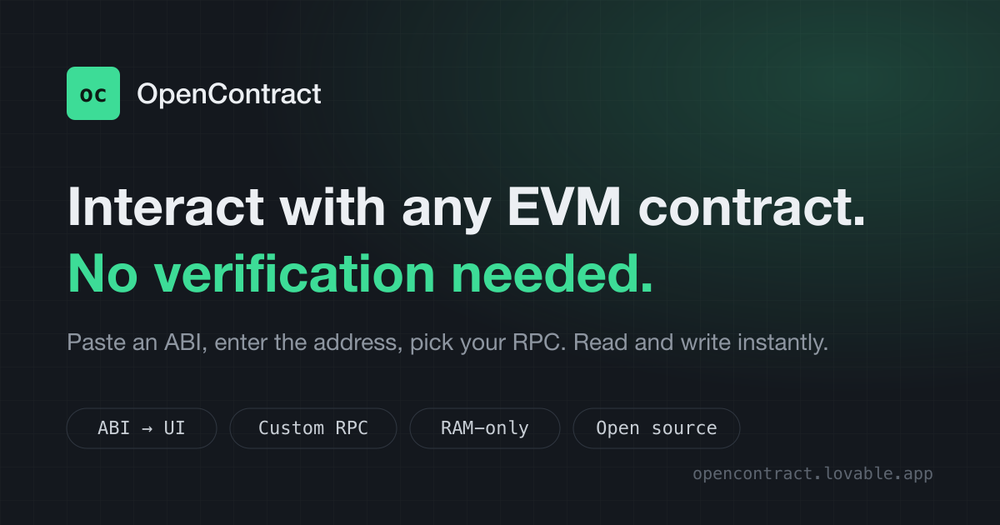

# OpenContract

**Interact with unverified smart contracts, right in your browser.**

Paste an ABI, enter the contract address, pick your network, and OpenContract generates a UI to read and write every function instantly. No explorer verification, no waiting for indexing, no CLI, no Remix.

**Live app: [opencontract.lovable.app](https://opencontract.lovable.app)**



## Why

You just deployed a contract, but it is not verified yet, or the block explorer is too slow to index it. The explorer's "Read / Write Contract" tabs are useless, so you fall back to `cast`, Hardhat scripts, or Remix.

OpenContract removes that friction. I built it for my own deployments, shared it with teammates, and the feedback was good enough to open-source it.

## Features

- **ABI to UI**: paste ABI JSON or a Hardhat/Foundry artifact and every function becomes a form.
- **Any EVM chain**: add a custom network with your own chain ID and RPC URL. The real chain ID is checked against the RPC.
- **Read without a wallet**: `view` and `pure` functions call the RPC directly.
- **Write with your wallet**: state-changing calls go through any EIP-1193 browser wallet (MetaMask, Rabby, and others) and are only sent after you confirm.
- **Proxy friendly**: point it at a proxy address and use the implementation ABI.
- **Events panel**: inspect contract events.
- **English and Vietnamese UI**.

## Privacy: RAM-only

Zero user data is stored. No localStorage, no cookies, no backend. Networks, contracts and ABIs live only in the current tab's memory. Reload or close the page and everything is gone.

## Use cases

- Interact with an unverified contract right after deployment.
- Call smart contract functions without verification on testnets, devnets and private chains.
- Read state from a custom RPC when the explorer has not indexed the contract.
- A lightweight Remix alternative for calling an already deployed contract.

## Tech stack

- React 19, TypeScript (strict), TanStack Start (SSR), Vite
- [viem](https://viem.sh) for all chain access, plus EIP-1193 `window.ethereum` (no wagmi, no ethers)
- Tailwind CSS v4 and shadcn/ui
- Vitest

## Run locally

Requires [Bun](https://bun.sh).

```sh
git clone https://github.com/mytoandeptrai/opencontract.git
cd opencontract
bun install
bun run dev
```

| Command | What it does |
| --- | --- |
| `bun run dev` | Start the dev server |
| `bun run build` | Production build |
| `bun run test` | Run tests (Vitest) |
| `bun run lint` | Lint |
| `bunx tsc --noEmit` | Typecheck |

## Project structure

```
src/
  routes/          TanStack Start file routes (SEO head lives here)
  components/oc/   App UI
  components/ui/   shadcn/ui primitives (generated)
  hooks/           React state: workspace, wallet, language
  lib/             Pure logic: chain, abi, args, errors, i18n, site metadata
public/            Static assets, OG image, sitemap, robots.txt
```

## Contributing

Issues and pull requests are welcome. Please keep the RAM-only rule: never add persistence of any kind.

## License

[MIT](LICENSE)

## Author

Built by **Tran Phuoc My Toan**: [LinkedIn](https://www.linkedin.com/in/tran-phuoc-my-toan-613971199/) · [GitHub](https://github.com/mytoandeptrai/)

If OpenContract saves you time, a star on [the repo](https://github.com/mytoandeptrai/opencontract) helps others find it.
